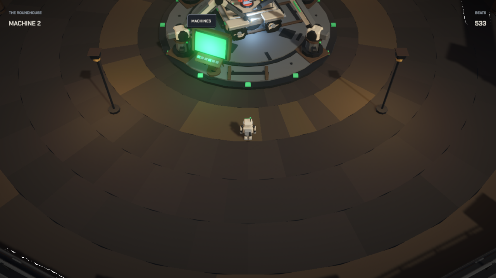
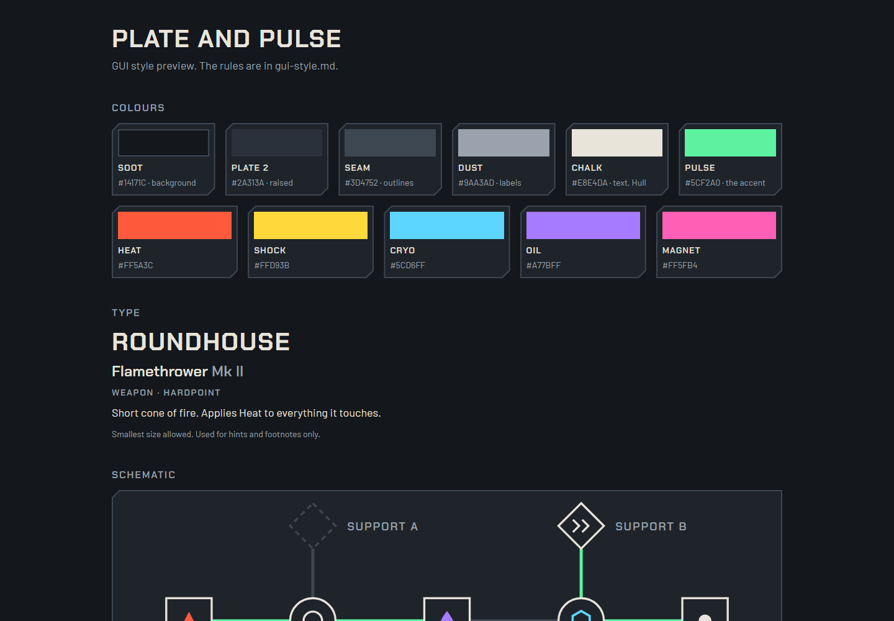

# Pulse

The home base, where you build and choose your machine.

## Download

You can download a playable Windows version from the [latest release](https://github.com/businessbaum/Pulse/releases/latest). Unzip it and start Pulse.exe. You can play with a keyboard or a controller. The file is not signed, so Windows may show a warning the first time. Click "More info" and then "Run anyway".

## What is this?

Pulse is a roguelike where you don't play a character. You play a machine that you build yourself. You choose a frame, a reactor, a drive and weapons. Wires on the frame connect the slots, and the wires decide which parts work together.

From your home base you drive out into an open world, fight enemies, go into dungeons and bring parts back home to make your machine stronger.

## What already works

- A home base where you walk around as a small robot and visit different machines: one builds your vehicle, one sells frames, one upgrades parts and one shows everything you found
- Six weapons and three elemental reactions
- An open world with three different areas and nine enemy types, each with a mini boss
- Three dungeons with their own maps and the first big boss
- Upgrades you choose during a run
- A save file that saves itself

## Design rules I set

- You steer relative to the machine, like a car, not relative to the screen.
- Enemy attacks always charge up first, so you can see them coming and dodge.
- As little text on screen as possible.

The interface follows a style guide I set up, made from gui-style-preview.html:

## Folders

| File or folder | Content |
|---|---|
| [machine-concept.md](machine-concept.md) | How the machine, its parts and the wiring work |
| [lore.md](lore.md) and [lobby.md](lobby.md) | The world, the story and the home base |
| [gui-style.md](gui-style.md) | The rules for the interface |
| [Pulse](Pulse) | The Unity project, with its own [README](Pulse/README.md) and the controls |

## Open the project

Open the Pulse folder with Unity 6, open the Lobby scene in Assets/Game/Scenes and press Play. There are 30 tests for the game rules and 15 tests that play the game automatically.

## License

All rights reserved, see [LICENSE](LICENSE). You can read the code, but you can't reuse it. The fonts have their own open license, see [ThirdParty/OFL-fonts.txt](ThirdParty/OFL-fonts.txt).
